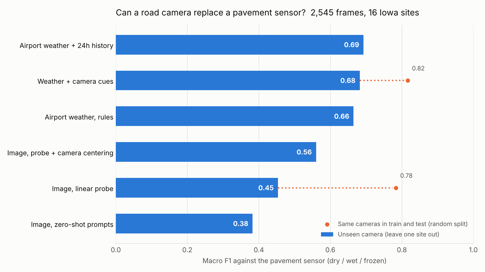
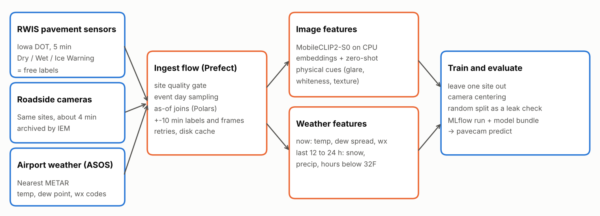
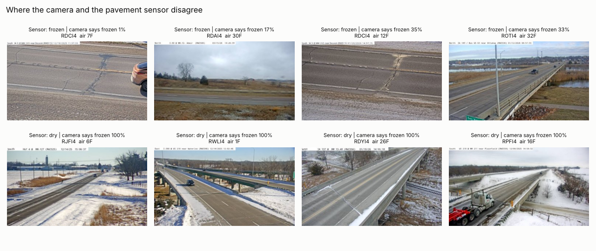

# pavecam

Can a roadside camera stand in for a pavement sensor?

Road agencies decide where to send plows and brine using RWIS stations: a pavement sensor
in the deck that reports Dry, Wet, Ice Warning and so on every few minutes. They are
expensive, so there are few of them. Traffic cameras are everywhere. pavecam tests, with real
data and an honest split, how far a camera (plus free public weather) can go toward the
reading a pavement sensor gives.

The trick that makes it possible without hand labeling: at RWIS sites the agency already
mounts a camera pointed at the instrumented deck. Every frame from that camera comes with a
free, objective label from the sensor a few meters away. pavecam pairs them automatically.



## Why now

* Winter road season has started in the northern US and agencies are still buying stations.
  On 5 Nov 2026 Cincinnati announced 10 more roadway weather stations on top of the 10 it
  installed last year ([WVXU, 2026-11-05](https://www.wvxu.org/politics/2026-11-05/cincinnati-new-snow-plow-tracker-more-road-condition-stations-winter-weather)).
* Recent papers report very high accuracy for camera based road condition models: over 98%
  with a CNN on stationary RWIS imagery ([Cold Regions Science and Technology 245, 104832, online 2026-01-19](https://www.sciencedirect.com/science/article/pii/S0165232X26000145)),
  and 93.7% on a held out test set that drops to 81.2% on 48 cameras from other countries
  ([Urban Science 10(5) 230, 2026-04-28](https://www.mdpi.com/2413-8851/10/5/230)). That drop is the
  question this repo measures directly: what happens on a camera the model never saw.
* Small vision language models now run on a laptop CPU. MobileCLIP2
  ([Apple, arXiv 2508.20691](https://arxiv.org/abs/2508.20691)) encodes a frame in under 100 ms on a laptop CPU,
  which makes a statewide virtual sensor cheap to run.

## What it does

1. **Ingest** (Prefect flow). Pulls winter 2025-26 RWIS pavement readings for 19 Iowa sites,
   applies a site quality gate, picks event days (frozen, wet, dry), lists the archived camera
   frames for those days, as-of joins frame, sensor label (within 10 minutes) and the nearest
   airport METAR (backward only, within 90 minutes), and downloads the frames. Retries with
   backoff on 5xx and timeouts, disk cache so reruns are free, bounded workers to be polite with
   a university server.
2. **Featurize**. For every frame: a MobileCLIP2-S0 embedding, zero-shot scores from a prompt
   ensemble (dry, wet, snowy or icy road), and ten physical cues (whiteness, glare, saturation,
   lane texture in the lower half of the frame). A frame gate drops black, blown out or flat frames.
   Weather features come from the nearest ASOS station: current temperature, dew point spread,
   present weather codes, and 12 to 24 hour history (snow reported, precipitation, hours below 32F).
3. **Train and evaluate**. Leave one site out cross validation, so every score is on a camera
   the model never saw. The same models are also scored with a random split to measure how much
   leakage inflates the number. Results, out of fold predictions and the model bundle go to MLflow.
4. **Predict**. `pavecam predict --camera IDOT-030-01` reads the live camera frame and the
   nearest airport weather and returns a reading with probabilities, an `uncertain` state below
   0.8 confidence, and a `review_camera` flag when the camera strongly contradicts the model.



## Results

All numbers come from the run in this repo: 2,545 daylight frames, 16 sites, 39 event days
between 2025-11-15 and 2026-03-15, MobileCLIP2-S0 (`dfndr2b` weights) on CPU. Labels: 1,060 dry,
959 wet, 526 frozen. Metric is macro F1 against the pavement sensor.

| Model | Unseen camera (leave one site out) | Random split |
|---|---|---|
| Image, zero-shot prompts | 0.38 (frozen recall 0.88) | |
| Image, linear probe on embeddings | 0.45 | 0.78 |
| Image, probe with camera centering | 0.56 | |
| Airport weather, hand rules | 0.66 | |
| Weather + camera cues (GBM) | 0.68 | 0.82 |
| **Airport weather + 24 h history (GBM)** | **0.69** | |

What the numbers say:

* **Random splits lie for cameras.** The image probe scores 0.78 when frames of the same camera
  are on both sides of the split and 0.45 on a new camera. It learns the camera, not the road.
* **Camera centering helps a lot.** Subtracting each camera's average embedding (computed from
  unlabeled frames only, so it works for a new camera after a few days of footage) lifts the image
  model from 0.45 to 0.56.
* **On the sensor's own definition, the camera did not beat the airport.** Weather with 24 hour
  history wins at 0.69, and adding camera cues does not improve it on unseen sites (0.68). The
  figure below shows why: the sensor reports frost or an ice warning on pavement that looks bare,
  and reports dry on a deck surrounded by snow. Both are physically right, and both are hard for
  a camera that sees the whole scene.
* **Triage works.** When the best model is at least 0.8 confident (61% of frames) accuracy is
  0.81 and frozen recall 0.80. The other 39% come back as `uncertain` instead of a wrong answer.
* Per site macro F1 ranges from 0.44 (Algona) to 0.81 (Pella), so a single statewide number hides
  a lot of spread.



Takeaway for a road agency: cameras are a cheap way to confirm snow cover and to flag sites for
review, but they are not a drop-in replacement for a pavement sensor on frost and black ice. Use
them to decide where the next station goes, not to skip it.

## Data sources

All data comes from the Iowa Environmental Mesonet (IEM) at Iowa State University, which states
that its materials are in the public domain and may be used freely for any lawful purpose
([IEM disclaimer](https://mesonet.agron.iastate.edu/disclaimer.php)). Thanks to the IEM for
archiving Iowa DOT feeds.

| Feed | Endpoint | Used for |
|---|---|---|
| Iowa DOT RWIS (`IA_RWIS`) | `/cgi-bin/request/rwis.py` | pavement condition labels |
| Iowa DOT RWIS cameras (`IDOT`) | `/archive/data/YYYY/MM/DD/camera/<id>/` | frames |
| ASOS airports (`IA_ASOS`) | `/cgi-bin/request/asos.py` | weather features |

Downloaded on 2026-11-11 for the window 2025-11-15 to 2026-03-15. The repo only ships a small
sample: `data/sample/features_sample.parquet` (412 real rows with features and embeddings, used by
tests and CI) and six frames downsized to 256 px. `pavecam ingest` rebuilds the full set (about
100 MB of frames). Frames are low resolution views of highways; no faces or readable plates.

## Run it

```bash
python -m venv .venv && source .venv/bin/activate
pip install -e ".[vision,dev]"          # CPU torch is enough

pavecam smoke        # offline, under a minute, trains and evaluates on the bundled real sample
pavecam ingest       # RWIS + ASOS + camera frames into data/ (about 3 min)
pavecam featurize    # MobileCLIP2 embeddings and cues (about 4 min on 2 CPU cores)
pavecam train        # leave one site out, random split check, MLflow run, model bundle
pavecam report       # figures in docs/
pavecam predict --camera IDOT-030-01                      # live reading
pavecam predict --camera IDOT-015-00 --time 2026-01-20T18:00
mlflow ui --backend-store-uri sqlite:///mlflow.db          # browse runs
```

Or with make: `make install`, `make all`, `make test`.

Tests: `pytest` (32 tests: label mapping, quality gate, day sampling, as-of tolerance, no
look-ahead in weather joins, METAR flag parsing, retry policy with a mocked transport, frame gate,
camera centering, leave one site out on the real sample, single frame scoring).

## Repo layout

```
src/pavecam/
  config.py    settings, env overrides (PAVECAM_*)
  sites.py     RWIS station to camera pairs, nearest station lookup
  labels.py    NTCIP surface codes to dry / wet / frozen
  iem.py       IEM client: retries, cache, frame listings
  dataset.py   pure functions: labels, quality gate, day sampling, as-of joins, weather history
  flows.py     Prefect flows: ingest and featurize
  vision.py    MobileCLIP2 encoder, prompts, physical cues, frame gate
  train.py     models, leave one site out, leak check, triage, MLflow, model bundle
  predict.py   virtual sensor for one camera
  report.py    figures
  cli.py       pavecam command
tests/         pytest suite
docs/          figures and ADRs
data/sample/   small real sample for tests and CI
```

## Decisions

* [ADR 001](docs/adr/001-sensor-labels-and-site-split.md): pavement sensors as labels, leave one site out
* [ADR 002](docs/adr/002-mobileclip2-frozen-encoder.md): frozen MobileCLIP2 on CPU instead of fine tuning
* [ADR 003](docs/adr/003-prefect-and-mlflow.md): Prefect for ingest, MLflow for runs

## Limitations

* Labels are a point sensor a few meters wide; the camera sees a whole scene. Some disagreement
  is not model error, it is two instruments measuring different things.
* Trace Moisture is mapped to wet, following the NTCIP meaning, but it is often invisible.
* Daylight only (09:00 to 15:00 local). Night frames need IR aware features.
* One state, one winter, 16 usable sites. Three sites were rejected by the quality gate
  (Manchester, New Hampton, Alton) because their sensors mostly reported Other or no code.
* The camera to station pairing comes from the current IEM inventory; a camera re-aimed during
  the winter would add label noise.
* Event day sampling over-represents storms compared to a typical day, so class frequencies
  are not climatology.

## What I would do in production

* Add the sequence: pavement state has memory, so a small temporal model over the last few
  frames and the sensor history would likely beat single frames.
* Segment the road surface (a lane mask per camera, drawn once) and compute features only there,
  which targets the snow beside the deck failure.
* Stream frames and METARs through Kafka, score per camera every 5 minutes and push the
  `review_camera` flags to the operations dashboard.
* Use the disagreement cases as an active learning queue for a few hundred human labels on
  visible snow cover, the thing cameras are good at.
* Expand to Minnesota and Wisconsin RWIS (also archived by IEM) to test across states.

## License

MIT, see [LICENSE](LICENSE). Data from the Iowa Environmental Mesonet, public domain.
